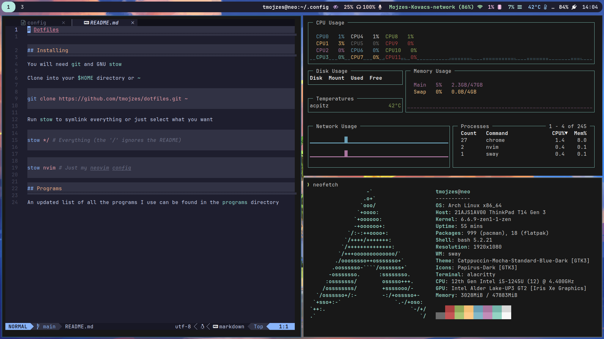

# Dotfiles



## Installing

You will need `git` and GNU `stow`

Clone into your `$HOME` directory or `~`

```bash
git clone https://github.com/tmojzes/dotfiles.git ~
```

Run `stow` to symlink everything or just select what you want

```bash
stow */ # Everything (the '/' ignores the README)
```

```bash
# Neovim is managed via Nixvim (github:tmojzes/nixvim) through Home Manager.
# The legacy LazyVim configuration is preserved in nvim/.
```

## Nix Configuration & Infrastructure

System configuration (NixOS), Home Manager, dev tools, and dotfiles (`bob`, `fonts`, `gemini`, `ghostty`, `git`, `lazygit`, `opencode`, `shell`) are managed in the [`infra`](https://github.com/tmojzes/infra) repository.
- **NixOS**: Rebuild system and user configuration together via `sudo nixos-rebuild switch --flake ~/infra#neo`.
- **macOS (Apple Silicon)**: Switch Home Manager via `home-manager switch --flake ~/infra#tmojzes-mac`.

## Programs

An updated list of all the programs I use can be found in the `programs` directory
